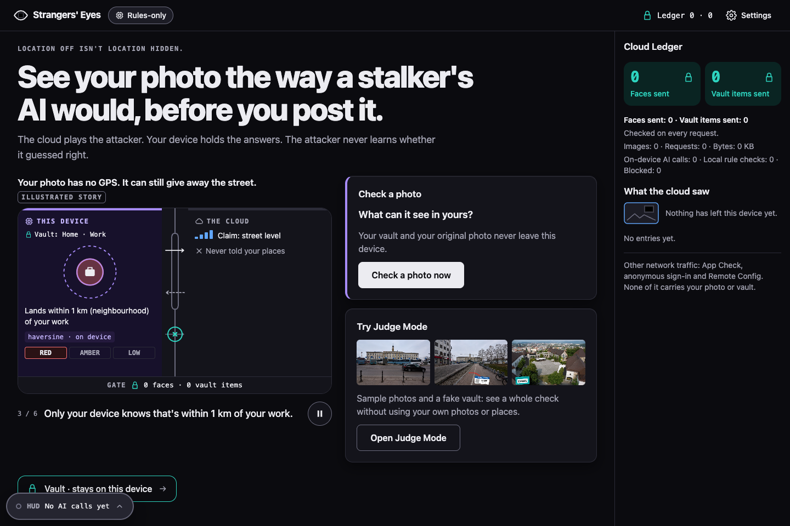
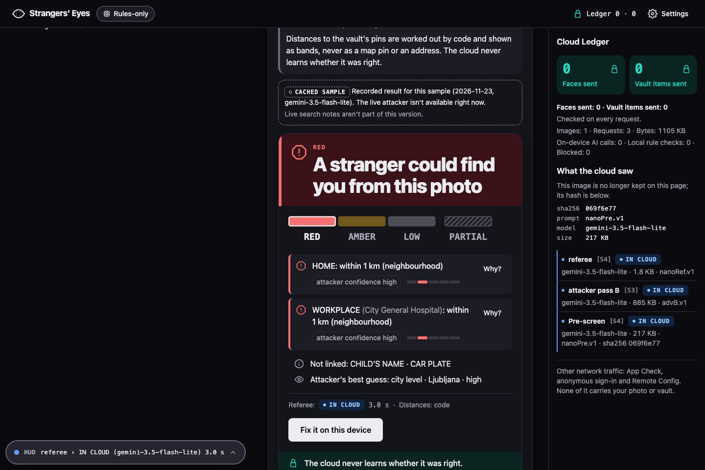
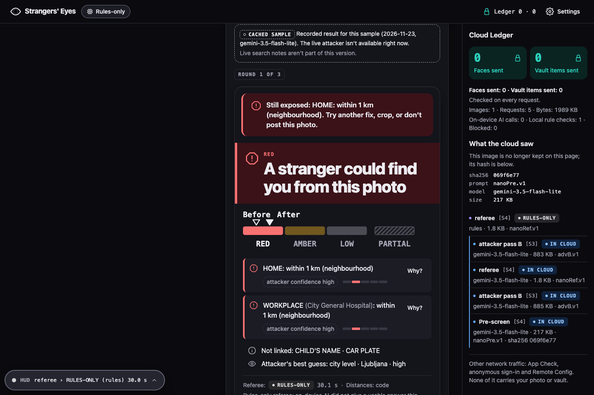

# Strangers' Eyes: see your photo the way a stalker's AI would, before you post it

[Live app](https://strangers-eyes.web.app) · [Demo video, under 3 min]([USER: YOUTUBE_URL after T-187]) · [Source]([USER: REPO_URL, public after T-170]) · [Apache-2.0](LICENSE) · Built for #BuildHybridAI 2026: Web PWA (hosted) and iOS (SwiftUI, run in the Simulator) · [USER: platforms and "Best of" category, T-172]

**Location off isn't location hidden.** A cloud AI tries to work out where your photo was taken; your own device decides whether it got close to home, and never tells it.

> The cloud plays the attacker. Your device holds the answers. The attacker never learns whether it guessed right.

**Value proposition:** find out what a stranger's AI could work out from your photo about where you live, where you work and what your children are called, and fix it before you post. Your secrets are never handed to any cloud.



---

## 1. Why (impact)

- Platforms strip GPS data, so people feel safe. Multimodal models now place photos from the pixels alone: street and transit signs, stop codes, shop fronts, lanyards, window views.
- Published studies report **up to** about 60% street-level (≤1 km) accuracy on social-media-like images, much lower on Street View-style images (Privacy International, "Nowhere to Hide?", Feb 2026). Accuracy also drops in less developed and sparsely populated regions (arXiv 2502.11163, EMNLP 2025).
- Our own small test agrees (§8): on 10 openly licensed photos of public places with GPS stripped and faces masked, a free-tier Gemini model placed 5 within 5 km, two of them at street level (about 200–250 m), and refused none.
- EXIF strippers ignore the pixels. Research prototypes send the raw photo to a cloud model and know nothing about what *you* need to hide.
- **Who it is for:** parents, marketplace sellers and creators. Highest need: domestic-violence survivors, journalists and activists. The threat and the fix are the same in every country.

**Why it has to be hybrid.** Attacking a photo needs world-scale visual knowledge, which only a large cloud model has. Judging the attack needs your secrets (home pin, workplace, children's names), which must never leave the device. The app splits the job at exactly that line.

## 2. Try it in 60 seconds (judges)

1. Open **https://strangers-eyes.web.app** in any desktop or mobile browser. No login (an anonymous session is created for you), no cost.
2. Confirm you are 18+, then choose **Open Judge Mode** (or go straight to `https://strangers-eyes.web.app/?judge=1`).
3. Pick a sample and press **Run this sample** (Autoplay is on by default). Each sample runs the loop: pre-screen, redacted copy, cloud attacker, on-device verdict, then the fix and the re-attack when there is something a mask can hide.
4. Watch the **Router HUD** (bottom left): every AI step says where it ran (`ON-DEVICE`, `IN CLOUD`, `RULES-ONLY`, or `CACHED SAMPLE`) and how long it took. The **Cloud Ledger** counts exactly what left the device.

No on-device AI is needed. With desktop Chrome and Gemini Nano enabled, the on-device steps run on Nano instead.

**What to expect: in our recorded runs, no sample ended in "Risk reduced".** We attacked the three samples live through the app on Nov 23 and kept the honest results (first run per sample, no reruns). A live run today may answer differently:

| Sample | First attack | After the fix | Verdict |
|---|---|---|---|
| 1. Station forecourt | the **wrong** city (Maribor, about 100 km away), read from the station sign | the fix masked the sign; the re-attack named the right city (Ljubljana) from the building itself | Still exposed |
| 2. Bike-share path + drawn staff badge | Ljubljana, within 1 km of the fake home and work pins | still Ljubljana, and it also inferred a workplace from the badge graphic | Still exposed |
| 3. Castle courtyard + drawn "LUCAS" lunchbox | Ljubljana Castle, 0.1 km from the fake work pin | only non-removable clues, so nothing to fix | Red: crop or don't post |

A mask cannot hide a famous landmark, and the app says so instead of claiming a win. The "LUCAS" tag (and the badge's header text, when OCR reads it) is masked **on the device** before anything is sent.

> **About the Judge Mode samples (please read).** The three sample photos are **CC0 photos of public places in Ljubljana** from Wikimedia Commons (credits in [`web/public/samples/SOURCES.md`](web/public/samples/SOURCES.md)). We solid-masked people, adverts showing people and real number plates, and **drew in the props**: a "City General Hospital" staff badge and a "LUCAS" name-tag lunchbox. The vault is made up, and its two pins sit in a park and a square. The **recorded attacker answers** that ship with the samples are the real answers from those Nov 23 live runs (`gemini-3.5-flash-lite`); they replay, labelled `CACHED SAMPLE`, only when the live attacker is unavailable (offline, quota or daily cap, kill switch, App Check failure, a timeout or a server error).

### Gallery

| | |
|---|---|
|  |  |
| A Judge Mode run: the device lane and the cloud lane, with every AI step badged in the Router HUD | A red verdict: the attacker's guess lands near the made-up home and work pins, shown as distance bands, never a map pin; the Cloud Ledger still reads "Faces sent: 0 · Vault items sent: 0". Shown with the recorded Nov 23 answer (CACHED SAMPLE): the free-tier attacker returned a server error during the screenshot run |
|  |  |
| Fix and re-attack: the fix masks the clues the attacker named, the fixed copy is attacked again, and the before/after compare shows the new verdict with the attacker's confidence (here the recorded Nov 23 answer, CACHED SAMPLE: still exposed) | The Egress Gate stops a copy that still shows a vault match ("LUCAS") before it can leave the device: BLOCKED, 0 bytes sent |
|  |  |
| About: what leaves this device, and the S0–S4 routing | Settings: what runs where on this browser |

## 3. How we use Firebase AI Logic hybrid inference


Every request is sorted by **what it carries**, and each class gets one inference mode. The policy is data in Remote Config (`routing_policy`), but a hard floor in code means Remote Config can never let S0 or S1 reach the cloud ([`web/src/core/routing.ts`](web/src/core/routing.ts)).


| Class | What it carries | Web (`firebase/ai`) | iOS (`FirebaseAILogic` 12.19.3) | No on-device model |
|---|---|---|---|---|
| **S0** | anything that touches the vault (referee, fix plan, vault-text match) | `ONLY_ON_DEVICE`, after a fresh availability check | on-device-only session (`FirebaseAI.SystemLanguageModel.default`, never a `HybridModel`) | deterministic code, labelled RULES-ONLY. **Never the cloud.** |
| **S1** | the original, unredacted photo (pre-screen) | `ONLY_ON_DEVICE`, after a fresh availability check | not built on iOS (T-125); Vision Tier-0 rules only | Tier-0 rules (RULES-ONLY). **Never the cloud.** |
| **S2** | public explanations of clue types | `PREFER_ON_DEVICE`, real SDK cloud fallback | `HybridModel` planned, not built (T-129) | cloud, badged IN CLOUD |
| **S3** | the attacker (pass B, re-attack) | `ONLY_IN_CLOUD` | `generativeModel` (cloud only; compiled, not yet run) | n/a |
| **S4** | Judge Mode samples with the fake vault | `PREFER_ON_DEVICE` | no Judge Mode on iOS | cloud, so judges without Nano see every AI step |

Why the fresh check matters: without `window.LanguageModel` (Safari, Firefox, mobile browsers), the web SDK silently sends even `ONLY_ON_DEVICE` requests to the cloud. So the gate checks `availability()` immediately before every S0/S1 call, with no cache, and runs deterministic code instead when the answer is not `'available'`.

### Jobs and call sites

Status words: **built** = in the hosted app; **verified** = seen working with the real model; **deferred** = cut for the demo path (D-141).

| Job | Class | Mode / engine | Model | Where (file) | Status |
|---|---|---|---|---|---|
| W1 Vault | local | code: AES-GCM, non-extractable key in IndexedDB | none | [`web/src/vault/vaultStore.ts`](web/src/vault/vaultStore.ts), [`web/src/vault/crypto.ts`](web/src/vault/crypto.ts) | built |
| W2 Tier-0 guard | local | MediaPipe faces, Tesseract OCR, EXIF strip by re-encode (not generative) | none | [`web/src/tier0/tier0.ts`](web/src/tier0/tier0.ts), [`web/src/tier0/faces.ts`](web/src/tier0/faces.ts), [`web/src/tier0/ocr.ts`](web/src/tier0/ocr.ts), [`web/src/tier0/exif.ts`](web/src/tier0/exif.ts) | built |
| W3a Pre-screen of the original | S1 | `ONLY_ON_DEVICE`, 768 px JPEG + JSON schema | Gemini Nano | [`web/src/ai/jobs/prescreen.ts`](web/src/ai/jobs/prescreen.ts), [`web/src/ai/jobs/prescreenClues.ts`](web/src/ai/jobs/prescreenClues.ts) | built, verified on Nano |
| W3b Vault-text match | S0 | `ONLY_ON_DEVICE` | Gemini Nano | deterministic matcher today: [`web/src/tier0/fuzzy.ts`](web/src/tier0/fuzzy.ts) | Nano job not built (T-067) |
| W4 Referee | S0 | `ONLY_ON_DEVICE`, JSON schema with per-call ID enums | Gemini Nano | [`web/src/ai/jobs/referee.ts`](web/src/ai/jobs/referee.ts); rules referee [`web/src/core/referee.ts`](web/src/core/referee.ts) | built, verified on Nano |
| W5 Fix planner | S0 | rules plan (masks every cited removable clue) | none yet | [`web/src/core/fixPlan.ts`](web/src/core/fixPlan.ts) | rules built; Nano planner not built (T-078) |
| W6 Masks and crop | local | solid fills, 15% padding | none | [`web/src/core/mask.ts`](web/src/core/mask.ts), [`web/src/core/boxes.ts`](web/src/core/boxes.ts) | built |
| W7 Egress Gate, tripwire, Ledger | all | code | n/a | [`web/src/ai/egressGate.ts`](web/src/ai/egressGate.ts), [`web/src/ai/tripwire.ts`](web/src/ai/tripwire.ts), [`web/src/core/ledger.ts`](web/src/core/ledger.ts) | built |
| W8 Clue explainer | S2 | `PREFER_ON_DEVICE` | Nano, else `gemini-3.5-flash-lite` | model factory `explainModel` in [`web/src/ai/models.ts`](web/src/ai/models.ts) | factory and gate path only; no screen yet (T-083, deferred) |
| C1 Pass A (grounded notes) | S3 | `ONLY_IN_CLOUD` + Google Search, display only | `gemini-3.5-flash-lite` (Remote Config `adversary_model`) | factory `adversaryAModel` in [`web/src/ai/models.ts`](web/src/ai/models.ts) | not wired; grounding is off on the free tier (T-070) |
| C2 Pass B (structured attack) | S3 | `ONLY_IN_CLOUD`, `responseJsonSchema` | `gemini-3.5-flash-lite` (Remote Config `adversary_model`; was `gemini-3.8-flash`, D-159) | [`web/src/ai/jobs/adversaryB.ts`](web/src/ai/jobs/adversaryB.ts), factory `adversaryBModel` in [`web/src/ai/models.ts`](web/src/ai/models.ts), schema [`shared/prompts/advB.v1.schema.json`](shared/prompts/advB.v1.schema.json) | built, verified: run live through the app's Egress Gate on the three Judge samples, Nov 23 (D-161) |
| C3 Re-attack and compare | S3 | as C2, on the fixed copy | as C2 | [`web/src/ui/check/fixFlow.ts`](web/src/ui/check/fixFlow.ts), [`web/src/ui/check/runSend.ts`](web/src/ui/check/runSend.ts) | built, verified: live re-attacks on Judge samples 1 and 2, Nov 23 |
| Judge Mode (S4) | S4 | `PREFER_ON_DEVICE` | Nano, else `gemini-3.5-flash-lite` | factory `judgeJsonModel` in [`web/src/ai/models.ts`](web/src/ai/models.ts); [`web/src/ui/judge/judgeFlow.ts`](web/src/ui/judge/judgeFlow.ts), [`web/src/ui/judge/judgeRun.ts`](web/src/ui/judge/judgeRun.ts) | built |
| I1 Vault (iOS) | local | one JSON file in Application Support with complete file protection, excluded from backup (not the Keychain) | none | [`ios/StrangersEyes/Vault/VaultStore.swift`](ios/StrangersEyes/Vault/VaultStore.swift) | built, run in the Simulator |
| I2 Tier-0 (iOS) | local | Vision faces and text, solid masks, ImageIO re-encode | none | [`ios/StrangersEyes/Tier0/Tier0.swift`](ios/StrangersEyes/Tier0/Tier0.swift), [`ios/StrangersEyes/Tier0/ImagePipeline.swift`](ios/StrangersEyes/Tier0/ImagePipeline.swift) | built, run in the Simulator |
| I3 FM pre-screen | S1 | on-device-only session, `@Generable` | Apple Foundation Models | not started | open (T-125) |
| I4 FM referee and rules fix | S0 | on-device-only session, `@Generable`; rules fallback | Apple Foundation Models | [`ios/StrangersEyes/AI/RefereeJob.swift`](ios/StrangersEyes/AI/RefereeJob.swift), [`ios/StrangersEyes/Core/Referee.swift`](ios/StrangersEyes/Core/Referee.swift), [`ios/StrangersEyes/Core/FixPlan.swift`](ios/StrangersEyes/Core/FixPlan.swift) | built, verified on Apple FM in the Simulator |
| I5 Explainer | S2 | `HybridModel` | FM, else Gemini | not started | open (T-129) |
| I6 Gate, Ledger, HUD (iOS) | all | code | n/a | [`ios/StrangersEyes/AI/EgressGate.swift`](ios/StrangersEyes/AI/EgressGate.swift), [`ios/StrangersEyes/Ledger/Ledger.swift`](ios/StrangersEyes/Ledger/Ledger.swift), [`ios/StrangersEyes/UI/RouterHUD.swift`](ios/StrangersEyes/UI/RouterHUD.swift) | built, run in the Simulator |

**Where the SDK is actually called.**
- Web, the Egress Gate: [`web/src/ai/egressGate.ts`](web/src/ai/egressGate.ts) imports from `firebase/ai` and is the only production file that calls `generateContent` / `generateContentStream`.
- Web, model configs: [`web/src/ai/models.ts`](web/src/ai/models.ts) is the only production file that calls `getGenerativeModel`, one factory per class and job (`deviceJsonModel` and `deviceTextModel` for S0/S1 with `ONLY_ON_DEVICE`, `explainModel` and `judgeJsonModel` with `PREFER_ON_DEVICE`, `adversaryAModel` and `adversaryBModel` with `ONLY_IN_CLOUD`). [`web/src/firebase/init.ts`](web/src/firebase/init.ts) calls `getAI` with the `GoogleAIBackend`.
- [`scripts/check-boundaries.mjs`](scripts/check-boundaries.mjs) fails the check if any other file calls the SDK. The only exceptions are the DEV-only Day-1 spikes in `web/src/dev/spikes/`, which predate the gate and are never in production builds.
- iOS: [`ios/StrangersEyes/AI/EgressGate.swift`](ios/StrangersEyes/AI/EgressGate.swift) has `import FirebaseAILogic`, the on-device `ai.generativeModelSession(model: FirebaseAI.SystemLanguageModel.default, instructions:)` for S0 (a new session per job), and the cloud `ai.generativeModel(modelName:generationConfig:systemInstruction:)` with `generateContent` for pass B. No `HybridModel` call site exists yet (I5, T-129).
- Model IDs, thinking levels, timeouts and prompt versions come from Remote Config ([`remoteconfig.template.json`](remoteconfig.template.json)). Prompts are versioned files in [`shared/prompts/`](shared/prompts/); Remote Config only selects a bundled version and never carries prompt text. Pass B times out at 45 s and is never retried on a timeout.

### The Egress Gate (one door for every AI call)

[`web/src/ai/egressGate.ts`](web/src/ai/egressGate.ts) (and its Swift mirror) handles every Firebase AI Logic call, on the device or in the cloud. For each call it:
1. checks the class the policy expects for that job, and refuses S0/S1 unless Nano (or Apple FM) reports `available` in that same call;
2. re-checks the **exact outgoing image bytes**: strict JPEG with no APP1/APP13/GPS metadata, the hash the user consented to, zero faces, zero OCR hits of vault text;
3. scans every dynamic prompt segment for vault strings and pin coordinates (an S2 payload that contains one is reclassified S0 and stays on the device);
4. runs the call, then confirms the route: a device-only call that reports `in_cloud` is treated as a breach and stops all cloud calls until reload;
5. writes exactly one Ledger entry (IDs, kinds, hashes, byte counts, route, latency; never vault text).

The Router HUD and the Cloud Ledger ("Faces sent: 0 · Vault items sent: 0", and "What the cloud saw") are drawn from those entries only.

## 4. Other Firebase products

- **App Check:** reCAPTCHA Enterprise on the hosted site; the debug provider on localhost and in the iOS Simulator.
- **Anonymous Auth:** per-user AI Logic quotas without any identity (web; not yet on iOS, T-120).
- **Remote Config:** routing policy, model names, prompt versions, timeouts, the daily attacker cap and a kill switch (web; iOS uses the bundled template defaults until T-120).
- **Hosting:** the web app at https://strangers-eyes.web.app.

Firestore was planned for an anonymous "Leak Atlas" and cut (D-141); the app writes nothing to any database.

## 5. Features

- First-run 18+ and "own photos only" confirmation.
- Private vault: home and work pins (one-shot location or manual coordinates), names, employer. Encrypted, never synced, never uploaded. Burn vault in two taps.
- Tier-0 guard on the device: face detection, OCR, vault-text matching, metadata stripping.
- Gemini Nano pre-screen of the original photo (S1), with solid masks applied before anything can leave.
- Consent sheet that shows the exact redacted image that will be sent.
- Cloud attacker (pass B) that lists the clues it used, with the confidence of each guess.
- On-device referee (S0): compares the attacker's guesses with your vault and shows **distance bands to your own pins** ("within 1 km (neighbourhood)", "same city area"), never a map pin or address for the guess.
- Verdict card, one-tap fix (masks or crop), re-attack, and a before/after compare that ends in **"Risk reduced"** (never "safe") or **"Still exposed"** with the next step (another fix, crop, or don't post).
- Egress Gate, Cloud Ledger, "What the cloud saw" and the Router HUD.
- Judge Mode with autoplay, three disclosed samples and labelled recorded answers when the live attacker is unavailable.
- An illustrated story on Home that explains the loop in about 18 seconds, with Pause/Play and a reduced-motion version.
- A lean iOS app in SwiftUI (§10).

## 6. Safety, privacy and dual use

**What never leaves the device:** the vault (pins, names, employer) and the original photo. The cloud only receives an EXIF-free copy with faces and vault-matched text solid-masked, after you approve the exact image shown. The attacker never learns whether it guessed right: grading happens on the device.

- S0 and S1 are `ONLY_ON_DEVICE` and fail closed: without a usable on-device model they run as deterministic RULES-ONLY code, never in the cloud.
- Masks are solid fills, never blur. Faces are always masked, and the gate blocks any detected face.
- Photos come from local files only; there is no URL input.
- Distances are computed in code (haversine plus bands), only relative to your own pins. No map, coordinates or address are shown for the attacker's guess.
- If Gemini declines or a safety filter blocks the request, the app shows "on-device findings only" and never retries with rephrased or role-play prompts, and never re-attacks.
- Grounded pass A (Search notes) is display-only by design: it is never parsed, cached or fed to code. It is not shown in the hosted app because grounding is off on the free tier.
- Copy says "Risk reduced", never "safe", and always shows the attacker's confidence.
- **Re-attack disclosure:** when you re-attack, the cloud sees which areas you masked, but never why.
- **Honesty about dual use:** the raw attacker JSON is visible in the browser's DevTools. The added harm over the public Gemini app is close to zero, and App Check, per-user limits, the daily cap and the kill switch do not stop a determined attacker. The app is built to show you your exposure, not to locate anyone.
- **Data tier:** the hosted app runs on the Gemini Developer API **free tier** (Firebase Spark plan, no billing). On the free tier, Google may use the redacted image and prompt to improve its products, and free-tier services may not be offered to users in the EEA, the UK or Switzerland. Search grounding is off. The vault and the original photo are never sent, whatever the tier. Users must be 18+.

## 7. Prior art and what is new

- "Raising Awareness of Location Information Vulnerabilities in Social Media Photos using LLMs", ACM CHI 2025, arXiv 2503.20226, DOI 10.1145/3706598.3714074: a warn, edit and re-analyse loop, studied with 19 participants over two weeks.
- Geo-Safe-Filter (TikTok TechJam 2025): Gemini finds clues, Grounding DINO draws boxes, OpenCV blurs; cloud backend.

**What is new here:**
1. a private on-device vault that acts as ground truth;
2. an on-device referee that grades the attacker, which never sees the result;
3. an enforced Egress Gate with a ledger that shows what left the device and blocks leaks as they happen;
4. routing by data-sensitivity class, stored as data in Remote Config and visible in the HUD.

## 8. Measured results and limitations

### The adversary test we ran (Day-1 spike, Nov 23)

Full aggregate report: [`benchmark/spike/day1-adversary.md`](benchmark/spike/day1-adversary.md) (aggregates only; no coordinates, place names or images are committed).

- **Set-up:** 10 openly licensed Wikimedia Commons photos of public places (streets, shop fronts, transit stops, public doorsteps). Every frame sent was a fresh re-encode with no GPS or EXIF metadata (only JFIF and colour-profile segments), with faces masked. Pass B only (prompt `advB.v1`, JSON schema), `gemini-3.5-flash-lite`, free tier. Up to 3 runs per photo: the third run was skipped when the first two already agreed, so 20 runs in all. Run with the DEV-only spike harness ([`benchmark/spike/run-spike.mjs`](benchmark/spike/run-spike.mjs)), not through the app.

| Measure | Result |
|---|---|
| Photos refused (≥ 2 runs declined or blocked) | **0 / 10** (0 / 20 runs) |
| Located within 5 km (≥ 2 runs) | **5 / 10** |
| Located within 1 km (≥ 2 runs) | **3 / 10**; two at street level (about 200–250 m) |
| G1 gate (≤ 2 refused, ≥ 4 located) | **PASS** |
| Fix: masking the clues the attacker marked removable, then re-attacking | moved **3 of the 4** re-attacked located photos outward (3 / 5 when the located photo with no removable clue counts as not moved) |
| Median radius of the closest guess, located photos | 0.60 km |
| G1b gate (fix moves ≥ 50%) | **PASS** |
| Latency per call | median 7.0 s, p90 9.4 s, max 10.9 s |

**Caveats:** n = 10, one model, pass B only, public places only. Wikimedia Commons photos may be in Gemini's training data, so the located counts may be optimistic compared with a never-published photo. **The planned 25-photo benchmark on builder-owned photos (T-150..T-153) was not run**, so there are no numbers from it.

### Other measurements

| What | Result | Where measured |
|---|---|---|
| Pass B through the app's own Egress Gate | the three Judge samples, attacked live; results in §2 | the app's Check flow on a local dev server, `gemini-3.5-flash-lite`, free tier, Nov 23 (D-161) |
| Referee (S0) on real Gemini Nano, through the Egress Gate | `ON-DEVICE`, ~6.1 s warm, 15.6 s cold | Chrome 157 on an Apple-silicon Mac, Nov 21 (D-154) |
| Pre-screen (S1) on real Gemini Nano, through the Egress Gate | `ON-DEVICE`, 2 clues on a drawn test image, ~9.5 s warm, 13.0 s cold | same |
| Tier-0 OCR on a "LUCAS" tag prop, 30 placements | 14/30 with default binarisation; 29/30 with the two-pass union the app uses (30/30 with a four-pass union in the spike) | Chrome 156, Nov 20 (T-037) |
| Free-tier `gemini-3.8-flash` latency in the adversary spike | 80–143 s when it answered, frequent 500/503 (server overload; 180 s server deadline) | Nov 21–23 (T-031) |
| iOS referee (S0) on Apple Foundation Models via Firebase's on-device session | `ON-DEVICE`, 29.6 s and 13.7 s | iOS 27.0 Simulator, Nov 21 |
| Web tests | 73 Vitest files, more than 3,300 tests, green; boundary scan green | `npm run check` |
| iOS tests | 20 XCTests green (cross-platform test vectors, gate tests) | `xcodebuild test` |

### Limitations (stated plainly)

- **In our recorded runs, Judge Mode did not end in "Risk reduced".** The attacker still placed all three samples in the right city from things a mask cannot hide (buildings, a castle, a badge graphic) (§2). We kept the honest results rather than pick easier photos.
- The attacker is `gemini-3.5-flash-lite` (D-159): free-tier `gemini-3.8-flash` was overloaded (500/503, and 80–143 s when it answered). Lite is nominally a weaker attacker, so the app may understate what a stronger model could infer. Pass B times out at 45 s and is not retried.
- **iOS: the real Gemini cloud path has not been exercised.** In the Simulator the app went red to "Risk reduced" with Apple FM on the device and a clearly labelled DEBUG fake attacker. Auth and Remote Config on iOS (T-120), the FM pre-screen (T-125) and the `HybridModel` explainer (T-129) are open. The Apple FM referee sometimes over-grades a match; the verdict keeps the stronger of the FM and rules answers.
- Grounded pass A (Search notes) and the S2 explainer are not in this build.
- Without Nano, S0/S1 run as deterministic RULES-ONLY code. Nano needs capable desktop hardware; Nano on the hosted origin is not yet verified (T-109).
- The adversary numbers come from 10 public-place photos that may be in the model's training data; public places are probably easier to locate than homes. Published work shows accuracy varies a lot by region (arXiv 2502.11163).
- The Cloud Ledger lives in memory and resets on reload.

## 9. Run it yourself

```bash
git clone [USER: REPO_URL, public after T-170] strangers-eyes
cd strangers-eyes
```

### Web
Requirements: Node ≥ 24.12 (tested with 26.8.2), npm, the Firebase CLI, and your own Firebase project.
1. In your Firebase project: enable Firebase AI Logic (Gemini Developer API), Anonymous Auth, App Check with reCAPTCHA Enterprise, and Remote Config.
2. Remote Config: the repo template [`remoteconfig.template.json`](remoteconfig.template.json) has paid-tier defaults. **On the free tier, publish a copy with `data_tier` set to `free` and `grounding_enabled` set to `false`.**
3. Put your project's web config and reCAPTCHA Enterprise site key in [`web/src/firebase/config.ts`](web/src/firebase/config.ts) (these values are public, not secret).
4. Register an App Check debug token for localhost and put it in `web/.env.development.local` as `VITE_APPCHECK_DEBUG_TOKEN=…` (see [`web/.env.example`](web/.env.example)). Never commit that file.
5. Run:
   ```bash
   cd web
   npm ci
   npm run dev      # http://localhost:5173 (if that port is busy, Vite picks the next free one; use the URL it prints)
   npm run check    # typecheck + boundary rules + prompt and image checks + Vitest
   npm run build    # production build + dist check
   ```
6. Deploy from the repo root: `firebase deploy --only hosting,auth --project <your-project>` (hosting runs the web build first). Publish Remote Config as in step 2. Never run a bare `firebase deploy`: it would publish the repo's Remote Config template, which ships paid-tier defaults.

Optional: for Gemini Nano, use desktop Chrome with on-device AI enabled (`chrome://settings/ai` and `chrome://flags/#prompt-api-for-gemini-nano-multimodal-input`), then reload; Settings shows what runs where on that browser.

### iOS
Requirements: Xcode 27.2, [XcodeGen](https://github.com/yonaskolb/XcodeGen), the iOS 27.0 Simulator (tested on iPhone 18 Pro), Apple Intelligence turned on on the Mac.
- **firebase-ios-sdk is pinned to exactly 12.19.3 because `HybridModel` was removed in 13.0.0.** 12.19.3 is the last release where Firebase AI Logic itself runs Apple Foundation Models on the device and reports the source (the iOS hybrid API is marked Experimental). The pin is in [`ios/project.yml`](ios/project.yml).
- Bring your own Firebase project: replace [`ios/StrangersEyes/Resources/GoogleService-Info.plist`](ios/StrangersEyes/Resources/GoogleService-Info.plist) with your project's file. In DEBUG builds the app uses the App Check debug provider; register your own debug token and pass it as the `AppCheckDebugToken` environment variable (for `simctl launch`, as `SIMCTL_CHILD_AppCheckDebugToken`). Never commit it.

```bash
cd ios
xcodegen generate
xcodebuild -project StrangersEyes.xcodeproj -scheme StrangersEyes \
  -destination "platform=iOS Simulator,name=iPhone 18 Pro" \
  -derivedDataPath build -clonedSourcePackagesDirPath .spm ARCHS=arm64 test
xcrun simctl boot "iPhone 18 Pro"
xcrun simctl install booted build/Build/Products/Debug-iphonesimulator/StrangersEyes.app
# DEBUG demo with no cloud calls: the labelled fake attacker and a test vault
xcrun simctl launch booted dev.strangerseyes.app -fakeAdversary -seedDemoVault -acceptWelcome
xcrun simctl shutdown all   # when done
```
Leave out `-fakeAdversary` to use the real Gemini pass B (not yet exercised; see §8). On an 8 GB Mac, do not run Chrome's Gemini Nano and the Simulator's Foundation Models at the same time. More detail: [`ios/NOTES.md`](ios/NOTES.md).

## 10. iOS status

A lean SwiftUI app (D-155) under [`ios/StrangersEyes/`](ios/StrangersEyes/) mirrors the web check on one screen:
- **Built and run in the iOS 27.0 Simulator:** the vault (a file with complete file protection, not the Keychain), Vision Tier-0 (faces and text, solid masks), a Swift Egress Gate with Ledger and Router HUD, an Apple Foundation Models referee with a rules floor, the consent sheet, verdict bands, the fix and the re-attack.
- **Seen working:** a UI test tapped through the whole flow: verdict red, fix, re-attack, then "Risk reduced: within 1 km (neighbourhood) → same city area". The referee ran on the device (Apple FM via Firebase's on-device session, 29.6 s and 13.7 s). The attacker was a DEBUG fake, labelled as such in the HUD; the Ledger read 0 · 0.
- **Tests:** `xcodebuild test` 20/20, including the same cross-platform test vectors as the web (bands, fuzzy match, referee, verdict).
- **Not done:** the real Gemini cloud call on iOS (compiled, not run; no quota spent), Anonymous Auth and Remote Config (T-120), the FM pre-screen (T-125), the `HybridModel` explainer (T-129).

## 11. Repo map

```
web/                 the web PWA (Vite, React, TypeScript)
  src/ai/            Egress Gate, model factories, tripwire, the AI jobs (src/ai/jobs/)
  src/core/          routing policy, bands, verdict, referee rules, fix plan, ledger
  src/tier0/         import, EXIF strip, faces, OCR, vault-text matcher
  src/vault/         encrypted vault store, burn
  src/ui/            screens, Check flow, Judge Mode, HUD and Ledger
  public/samples/    Judge Mode samples, recorded answers, manifest and SOURCES.md
ios/                 SwiftUI app (XcodeGen spec in ios/project.yml; status in ios/NOTES.md)
shared/prompts/      versioned prompts and schemas (with manifest.json)
shared/strings/      UI copy (en.json)
shared/testvectors/  cross-platform test vectors (Vitest and XCTest)
scripts/             boundary, prompt, image and dist checks; sample tools
benchmark/spike/     Day-1 adversary spike: harness, scorer and the aggregate report
docs/                spec, architecture, API notes, runbook, tasks, progress, devlog
docs/img/            architecture and routing diagrams, screenshot gallery
remoteconfig.template.json, firebase.json
```

## 12. Built during #BuildHybridAI

- New project, started Nov 19 2026. There is no pre-existing code.
- Written with **Claude Code** (an AI coding assistant), starting from the create-vite template. The team made the product and design decisions.
- Third-party libraries and their licences: [`THIRD_PARTY_NOTICES.md`](THIRD_PARTY_NOTICES.md).

## 13. Roadmap

- The 25-photo benchmark on builder-owned photos, and a stronger attacker model once quota allows.
- The real Gemini pass B, Auth, Remote Config and the `HybridModel` explainer on iOS.
- Android with Gemini Nano, on the same Firebase project (cut from this entry: no device to test on).
- Grounded pass A notes with Search Suggestions, and the S2 explainer, once on the paid tier.
- A "check before you post" browser extension; non-English UI.

## 14. License

Apache License 2.0. See [LICENSE](LICENSE) and [NOTICE](NOTICE).
