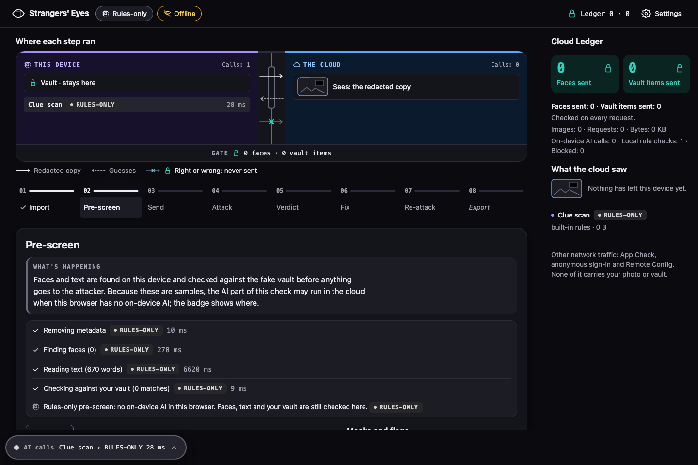
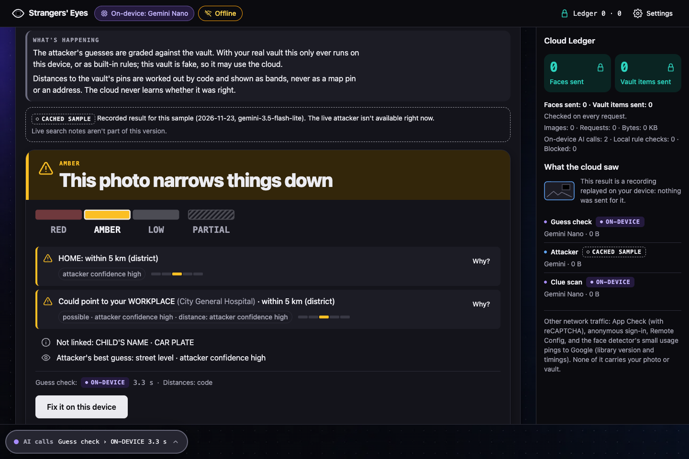
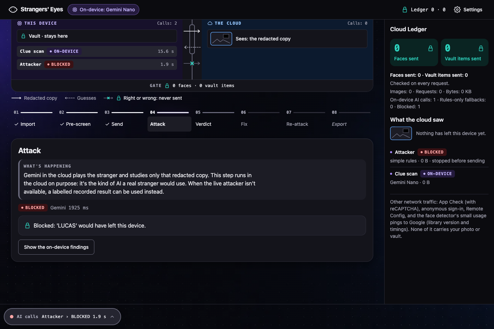
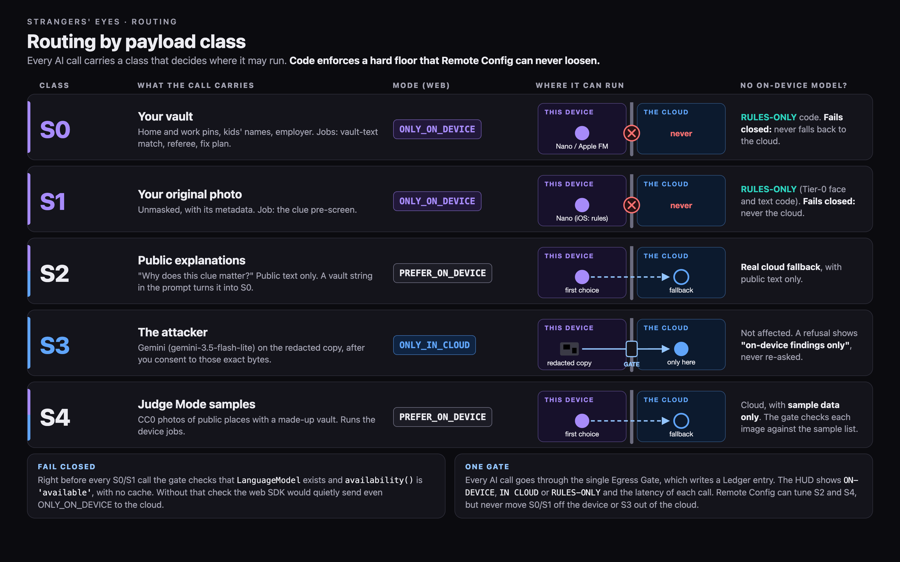

# Strangers' Eyes: see your photo the way a stalker's AI would, before you post it

[Live app](https://strangers-eyes.web.app) · [Demo video, under 3 min](https://youtu.be/_1SQMxDQpHk) · [Source](https://github.com/PRIEST099/strangers-eyes) · [Apache-2.0](LICENSE) · Built for #BuildHybridAI 2026: Web PWA (hosted) and iOS (SwiftUI, run in the Simulator) · [USER: platforms and "Best of" category, T-172]

- **The lunchbox test.** Careful parents cover their child's face before posting. We drew a made-up name on a card in fresh photos of public places: a cloud model asked to read them read the name in 23 of 23, and in 23 of 23 again through a light blur. Behind the app's solid box: 0 of 23 (§7).
- **The cloud plays the attacker.** Gemini, through Firebase AI Logic, tries to work out where your photo was taken, from a redacted copy.
- **Your device holds the answers.** It grades the guess against a private vault (home, school and work pins, your employer, your children's names), masks the clues the attacker used, and lets it try again.
- **The attacker is never told whether it guessed right.** The vault and the original photo never leave the device.
- **Measured on the local dev build, a full check with Gemini Nano on** (Nov 26, D-176; [`docs/egress-measurement.md`](docs/egress-measurement.md), script [`scripts/measure-egress.mjs`](scripts/measure-egress.mjs)): a benchmark street photo through the normal Check flow with a made-up vault (two pins, "City General Hospital", "LUCAS"), first attack, fix and re-attack. Exactly two images left: one redacted 1536 × 1152 JPEG per attack (295 KB and 290 KB, no metadata, the same bytes the consent sheet showed) with the fixed prompt, 399 KB and 392 KB per request. The photo had no faces or vault text, so this tests what is sent, not the masks (the text experiment in §7 tests those). No vault word, no pin coordinate (searched at 3 to 6 decimals), no true location and no byte of the 2.1 MB original appeared in any request. The Cloud Ledger matched the network (2 images, 2 requests, 791 KB). Pre-screen and both guess checks ran on Gemini Nano (22.3 s, 3.4 s, 4.2 s). One undisclosed request was found; the next deploy discloses it: the face detector (MediaPipe) sends small usage pings to Google (38–87 bytes: library version, task, timings; no image or vault data). An earlier Nov 24 check on the hosted app, without Nano, saw the same for the first attack.


---

## 1. Try it in 2 minutes (Judge Mode)

1. Open **https://strangers-eyes.web.app** in any browser. No login, no cost.
2. Confirm you are 18+, choose **Open Judge Mode** (or open `https://strangers-eyes.web.app/?judge=1`), pick a sample and press **Run this sample**. Autoplay runs pre-screen, consent, attack and verdict, then fix and re-attack when a mask can help.
3. Turn on **Technical details** to see where each AI step ran (`ON-DEVICE`, `IN CLOUD`, `RULES-ONLY` or `CACHED SAMPLE`) and how long it took. Steps that always run as code or a small local model on the device (metadata, MediaPipe faces, Tesseract text, the vault match, the fix plan, distance bands) read `BUILT-IN`; `RULES-ONLY` means an on-device AI step fell back (D-179). The **Cloud Ledger** counts what left the device.

No on-device AI is needed. With Gemini Nano in desktop Chrome, the private steps run on Nano. Without it, Judge Mode runs them in the cloud on the made-up vault (labelled IN CLOUD), and your own photos use simple rules (RULES-ONLY), never the cloud.

**Three outcomes: a fix that helps, one that isn't enough, a photo that can't be fixed.** Live attacks through the app on Nov 23, first answer kept; a live run today may differ.

| Sample | First attack | After the fix | Verdict |
|---|---|---|---|
| 1. Station forecourt | read the station sign and named the **wrong** city, about 100 km away | sign masked; the re-attack found the right city from the building itself | Still exposed |
| 2. Level crossing by a street sign (Berlin) | street level, from the street sign and its house-number plate: within 5 km of the made-up home and work pins | both masked; the re-attack got only the city | **Risk reduced** (amber → low) when the cloud or the rules do the guess check, and on iOS with Apple's model; with Gemini Nano it varies: **Still exposed** 6 times and **Risk reduced** 4 times in 10 runs (the video shows a Still exposed run, the gallery a Risk reduced one) |
| 3. Castle courtyard + drawn "LUCAS" lunchbox | 0.1 km from the made-up work pin | only clues a mask can't remove | Red: crop or don't post |

> **About the samples (please read).** The three photos are **CC0 photos of public places** from Wikimedia Commons, two in Ljubljana and one in Berlin (credits in [`web/public/samples/SOURCES.md`](web/public/samples/SOURCES.md)). We solid-masked people, adverts showing people and real number plates, and **drew in a prop** (the "LUCAS" lunchbox, which the app masks on the device before anything is sent). The vault is made up; each sample's pins sit in a park and a square near the photo. Sample 2 replaced a bike-share photo that ended "Still exposed": we tried six Berlin photos, Google's model was overloaded during most runs, and the level crossing is the one that got a complete answer. The **recorded answers** that ship with the samples are the real Nov 23 answers (`gemini-3.5-flash-lite`); they replay, labelled `CACHED SAMPLE`, only when the live attacker is unavailable (offline, quota or daily cap, kill switch, App Check failure, a timeout or a server error). A replay sends nothing itself, but the Cloud Ledger still counts what already left: a live attempt that timed out or got a server error had sent the redacted copy, and without Nano the S4 sample pre-screen and referee run in the cloud. It reads zero only when Nano ran the private steps and no live attack was tried (offline, daily cap, kill switch).

### Gallery

| | |
|---|---|
|  |  |
| A Judge Mode run, each AI step labelled with where it ran | Level crossing, first verdict: distance bands to the made-up pins, never a map pin (recorded answer, CACHED SAMPLE) |
|  |  |
| Fix and re-attack: signs masked, the AI could only name the city. Risk reduced on this Nano run; the video's run said Still exposed (CACHED SAMPLE) | The Egress Gate blocks a copy that still shows "LUCAS": 0 bytes sent |
|  |  |
| What leaves this device | What runs where on this browser |

## 2. Why it matters, and why hybrid

- Turning location off strips GPS data, not the street sign. Published studies report **up to** about 60% street-level (≤1 km) accuracy on social-media-like images, much lower on Street View-style images ([Privacy International, "Nowhere to Hide?"](https://privacyinternational.org/report/5736/nowhere-hide-privacy-risks-and-policy-implications-ai-geolocation), Feb 2026), and lower again in sparsely populated regions (arXiv 2502.11163, EMNLP 2025).
- Our held-out test confirms the risk, at the lower end of that range (§7): on 36 GPS-free photos of public places uploaded in the two weeks before the run, a free-tier Gemini model placed 8 within 5 km (95% interval 12–38%), 5 of them within 1 km, mostly street scenes, and refused none of 126 runs.
- **Who it is for:** first, a parent or grandparent about to post a photo of a child (a first day of school, a birthday, the walk home); also anyone for whom a photo's location is itself the danger, such as someone who has moved away from a former partner. No parent has tested it yet.

**Why it has to be hybrid.** Placing a photo needs world-scale visual knowledge that only a large cloud model has. Judging the attack needs your secrets, which must never leave the device. The app splits the job at exactly that line.

## 3. How we use Firebase AI Logic hybrid inference


Every request is sorted by **what it carries**, and each class gets one inference mode. The policy is data in Remote Config (`routing_policy`); a hard floor in code means Remote Config can never let S0 or S1 reach the cloud ([`web/src/core/routing.ts`](web/src/core/routing.ts)).



| Class | What it carries | Web (`firebase/ai`) | iOS (`FirebaseAILogic` 12.19.3) | No on-device model |
|---|---|---|---|---|
| **S0** | anything touching the vault (the referee; the fix plan and the vault-text match are always code, `BUILT-IN`) | `ONLY_ON_DEVICE`, after a fresh availability check | on-device-only session (`FirebaseAI.SystemLanguageModel.default`, never a `HybridModel`) | deterministic code, labelled RULES-ONLY. **Never the cloud.** |
| **S1** | the original photo (pre-screen) | `ONLY_ON_DEVICE`, after a fresh availability check | on-device-only session: Apple FM reads Vision's OCR text and scene labels (text only, never the image) | rules (RULES-ONLY). **Never the cloud.** |
| **S2** | public explanations of clue types | `PREFER_ON_DEVICE`, real cloud fallback | `HybridModel` planned (T-129) | cloud, labelled IN CLOUD |
| **S3** | the attacker (pass B, re-attack) | `ONLY_IN_CLOUD` | `generativeModel` (built, not yet run) | n/a |
| **S4** | Judge Mode samples with the fake vault | `PREFER_ON_DEVICE` | Judge Mode replays the recorded answers; Apple FM grades on the device | cloud, so judges without Nano see every step |

Why the fresh check matters: without `window.LanguageModel` (Safari, Firefox, mobile browsers) the web SDK silently sends even `ONLY_ON_DEVICE` requests to the cloud. So the gate checks `availability()` immediately before every S0/S1 call, with no cache, and runs deterministic code unless the answer is `'available'`.

### Jobs and call sites

**built** = in the hosted app; **verified** = seen working with the real model.

| Job | Class, mode | Model | Where | Status |
|---|---|---|---|---|
| W1 Vault | local, AES-GCM, non-extractable key | none | [`vaultStore.ts`](web/src/vault/vaultStore.ts) | built |
| W2 Tier-0 guard | local: faces, OCR, EXIF strip | MediaPipe, Tesseract | [`tier0.ts`](web/src/tier0/tier0.ts) | built |
| W3a Pre-screen of the original | S1 `ONLY_ON_DEVICE`, JSON schema | Gemini Nano | [`prescreen.ts`](web/src/ai/jobs/prescreen.ts) | verified on Nano |
| W3b Vault-text match | S0, deterministic today | (Nano planned, T-067) | [`fuzzy.ts`](web/src/tier0/fuzzy.ts) | rules built |
| W4 Referee | S0 `ONLY_ON_DEVICE`, per-call ID enums | Gemini Nano; rules fallback | [`ai/jobs/referee.ts`](web/src/ai/jobs/referee.ts), [`core/referee.ts`](web/src/core/referee.ts) | verified on Nano |
| W5 Fix planner, W6 masks | S0 rules; solid fills, 15% padding | (Nano planner T-078) | [`fixPlan.ts`](web/src/core/fixPlan.ts), [`mask.ts`](web/src/core/mask.ts) | built |
| W7 Egress Gate, tripwire, Ledger | all | n/a | [`egressGate.ts`](web/src/ai/egressGate.ts), [`tripwire.ts`](web/src/ai/tripwire.ts), [`ledger.ts`](web/src/core/ledger.ts) | built |
| W8 Clue explainer | S2 `PREFER_ON_DEVICE` | Nano, else flash-lite | `explainModel` in [`models.ts`](web/src/ai/models.ts) | factory only (deferred, T-083) |
| C1 Pass A (grounded notes) | S3 `ONLY_IN_CLOUD` + Search, display only | `adversary_model` | `adversaryAModel` in [`models.ts`](web/src/ai/models.ts) | not wired; grounding off on free tier |
| C2 Pass B (attack) | S3 `ONLY_IN_CLOUD`, JSON schema; Remote Config `adversary_fallback_models` can name backup models for a 5xx or 429, but the list ships empty (no failover today) | `gemini-3.5-flash-lite` (D-159) | [`adversaryB.ts`](web/src/ai/jobs/adversaryB.ts), [`advB.v1.schema.json`](shared/prompts/advB.v1.schema.json) | verified live on the 3 samples, Nov 23 |
| C3 Re-attack and compare | S3, on the fixed copy | as C2 | [`fixFlow.ts`](web/src/ui/check/fixFlow.ts) | verified live on samples 1 and 2 |
| Judge Mode | S4 `PREFER_ON_DEVICE` | Nano, else flash-lite | [`judgeRun.ts`](web/src/ui/judge/judgeRun.ts) | built |
| I1–I2 Vault, Tier-0 (iOS) | local: protected file; Vision masks | none | [`VaultStore.swift`](ios/StrangersEyes/Vault/VaultStore.swift), [`Tier0.swift`](ios/StrangersEyes/Tier0/Tier0.swift) | built, Simulator |
| I4 Referee and rules fix (iOS) | S0 on-device-only session, `@Generable` | Apple FM; rules floor | [`RefereeJob.swift`](ios/StrangersEyes/AI/RefereeJob.swift) | verified on Apple FM, Simulator |
| I6 Gate, Ledger, HUD (iOS) | all | n/a | [`EgressGate.swift`](ios/StrangersEyes/AI/EgressGate.swift) | built, Simulator |
| I7 Judge Mode (iOS) | S4, recorded Gemini answers graded on the device | Apple FM; rules floor | [`JudgeSamples.swift`](ios/StrangersEyes/Judge/JudgeSamples.swift), [`JudgeViews.swift`](ios/StrangersEyes/UI/JudgeViews.swift) | built, Simulator |
| I3 Pre-screen (iOS) | S1 on-device-only session, text only (OCR lines and scene labels) | Apple FM; RULES-ONLY fallback | [`PrescreenJob.swift`](ios/StrangersEyes/AI/PrescreenJob.swift) | verified on Apple FM, Simulator (Nov 24) |
| I5 Explainer (iOS) | S2 `HybridModel` | Apple FM, else cloud | — | open (T-129) |

**Where the SDK is called.**
- Web: [`egressGate.ts`](web/src/ai/egressGate.ts) is the only production file that calls `generateContent` / `generateContentStream`; [`models.ts`](web/src/ai/models.ts) is the only one that calls `getGenerativeModel` (one factory per class and job); [`init.ts`](web/src/firebase/init.ts) calls `getAI` with the `GoogleAIBackend`. [`scripts/check-boundaries.mjs`](scripts/check-boundaries.mjs) fails the build if any other file calls the SDK (the only exceptions are DEV-only Day-1 spikes in `web/src/dev/spikes/`, never in production builds).
- iOS: [`EgressGate.swift`](ios/StrangersEyes/AI/EgressGate.swift) uses `ai.generativeModelSession(model: FirebaseAI.SystemLanguageModel.default, instructions:)` for S0 and S1 (a new session per job) and `ai.generativeModel(modelName:generationConfig:systemInstruction:)` with `generateContent` for pass B. No `HybridModel` call site yet (T-129).
- Model IDs, timeouts and prompt versions come from Remote Config; prompt text lives only in [`shared/prompts/`](shared/prompts/). Pass B times out at 45 s, no retry on timeout.

### The Egress Gate (one door for every AI call)

For each call, [`egressGate.ts`](web/src/ai/egressGate.ts) (and its Swift mirror):
1. checks the class the policy expects, and refuses S0/S1 unless Nano (or Apple FM) reports `available` in that same call;
2. re-checks the **exact outgoing bytes**: strict JPEG with no APP1/APP13/GPS metadata, the hash you consented to, zero faces, zero OCR hits of vault text;
3. scans every dynamic prompt segment for vault strings and pin coordinates (an S2 payload containing one becomes S0 and stays on the device);
4. confirms the route afterwards: a device-only call that reports `in_cloud` is a breach and stops all cloud calls until reload;
5. writes one Ledger entry (IDs, hashes, byte counts, route, latency; never vault text). The Cloud Ledger and the per-step route labels are drawn from those entries only.

**Other Firebase products:** App Check (reCAPTCHA Enterprise on the hosted site, the debug provider on localhost and in the Simulator); Anonymous Auth (per-user AI quotas without identity; web only, T-120); Remote Config (routing, models, prompt versions, timeouts, daily cap, kill switch; iOS uses bundled defaults until T-120); Hosting. Firestore was cut (D-141): the app writes nothing to any database.

## 4. Safety, privacy and misuse

**Never leaves the device:** the vault and the original photo. The cloud only receives an EXIF-free copy with faces and vault-matched text solid-masked, after you approve the exact image.

- **Not a geolocation tool.** A "where was this taken" app would help stalkers. So the app never shows the attacker's guessed place (no place name, map pin or address): only how precise the guess was (street, city, country…), its confidence and the kinds of clues it used, plus **distance bands to your own pins**, computed in code (haversine). With an empty vault it tells you how exposed a photo is, not where it is.
- S0 and S1 fail closed to RULES-ONLY code. Masks are solid fills, never blur; the gate blocks any detected face. Photos come from local files only. First run asks for 18+ and "own photos only".
- If Gemini declines or a safety filter blocks the request, the app shows "on-device findings only" and never retries or re-attacks. Copy says "Risk reduced", never "safe", with confidence. Grounded pass A (display-only, never fed to code) and the S2 explainer are not in this build.
- **Honest limits:** the raw attacker answer is visible in DevTools, which adds little over asking Gemini directly; App Check, per-user limits, the daily cap and the kill switch limit volume, not intent. On a re-attack the cloud sees which areas you masked, never why.
- **Data tier:** the hosted app runs on the Gemini Developer API **free tier** (Firebase Spark, no billing). Google may use the redacted image and prompt to improve its products (the consent screen says so), and free-tier services may not be offered in the EEA, the UK or Switzerland. Search grounding is off.

## 5. How it compares

- **AI and OSINT geolocation** ([GeoSpy](https://www.404media.co/the-powerful-ai-tool-that-cops-or-stalkers-can-use-to-geolocate-photos-in-seconds/), [Bellingcat's geolocation work](https://www.bellingcat.com/tag/geolocation/)): the attacker's view. We run it as a self-test and hide the answer.
- **EXIF strippers** ([Scrambled Exif](https://f-droid.org/en/packages/com.jarsilio.android.scrambledeggsif/)): remove GPS, not the street sign in the picture.
- **Image cloaking** ([Fawkes](https://news.uchicago.edu/story/new-tool-protect-yourself-against-facial-recognition-software), UChicago SAND Lab): protects faces from recognition models, not places.
- **Before-you-post location checkers:** "Raising Awareness of Location Information Vulnerabilities in Social Media Photos using LLMs" ([ACM CHI 2025, arXiv 2503.20226](https://arxiv.org/abs/2503.20226); a warn, edit and re-analyse loop with 19 participants) and [Geo-Safe-Filter](https://awpbash.github.io/projects/geo-safe-filter) (TikTok TechJam 2025; Gemini via API finds the clues, then they are blurred). Both send the photo to a cloud model and don't know which places matter to you.

**New here:** a private on-device vault as ground truth; an on-device referee the attacker never hears from; an enforced Egress Gate with a ledger; routing by data sensitivity, stored in Remote Config.

## 6. iOS status

A lean SwiftUI app (D-155) in [`ios/StrangersEyes/`](ios/StrangersEyes/), run in the iOS 27.0 Simulator: the vault (a file with complete file protection, not the Keychain), Vision Tier-0 masks, a Swift Egress Gate with Ledger and route labels, an Apple Foundation Models referee with a rules floor, consent, verdict bands, fix and re-attack. **iOS Judge Mode** replays the same recorded Gemini answers as the web, graded by Apple FM on the device. An Apple FM **pre-screen** ([`PrescreenJob.swift`](ios/StrangersEyes/AI/PrescreenJob.swift)) reads Vision's OCR text and scene labels, never the image, as S1 on the device, falling back to RULES-ONLY. On Nov 24 a UI test ran Judge sample 2 with no stand-in attacker: pre-screen ON-DEVICE (Apple FM), the recorded attack (CACHED SAMPLE), referee ON-DEVICE (19.4 s), fix, recorded re-attack, referee ON-DEVICE (14.2 s), ending **"Risk reduced"** with 0 requests and 0 bytes sent ([`ios/NOTES.md`](ios/NOTES.md)). An earlier Nov 21 run used a clearly labelled DEBUG stand-in attacker. 32 XCTests pass (Nov 24) and share cross-platform test vectors with the web (bands, fuzzy match, referee, verdict). On Nov 27 the iOS app made its first live Gemini call, from the iOS 27 Simulator with a registered App Check debug token: a drawn, made-up street scene through the normal own-photo flow, pre-screen ON-DEVICE (Apple FM, 82.7 s on a cold start), consent to the exact copy, the attack IN CLOUD (`gemini-3.5-flash-lite` through Firebase AI Logic, 6.6 s), a LOW verdict with nothing linked to the demo vault (the referee needed no model: BUILT-IN · code). One call, in the Simulator only (no physical iPhone). **Not done:** Anonymous Auth and Remote Config on iOS (T-120), the `HybridModel` explainer (T-129).

## 7. Measured results and limitations

### The held-out benchmark (Nov 26, D-174)

Aggregates only: [`benchmark/bench/results.md`](benchmark/bench/results.md) (and `results.json`). 40 openly licensed Wikimedia Commons photos of public places with a recorded camera position, **uploaded Nov 13–26, 2026**, so they are unlikely to be in the model's training data. They were chosen by a protocol written before any image was viewed (hash order, one per uploader, ≥ 25 km apart; rejected only for people, homes, schools, interiors or non-places). The same redacted copy the app sends (EXIF stripped, faces solid-masked, ≤ 1536 px), `gemini-3.5-flash-lite` on the free tier, prompt `advB.v1`, **3 runs per photo, all run**. A photo is located if the closest of its ≤ 3 guesses is within the distance in at least 2 of 3 runs; distances are code (haversine), never the model. Scorer: [`score-bench.mjs`](benchmark/bench/score-bench.mjs) (Wilson 95% intervals, self-tested).

| Measure | Result | 95% interval |
|---|---|---|
| Located within 5 km | **8 / 36** (22%) | 12–38% |
| Located within 1 km | **5 / 36** (14%) | 6–29% |
| Located within 25 km (city) | 11 / 36 (31%) | 18–47% |
| Refused runs | **0 / 126** | 0–3% |
| By place type, within 5 km | street scenes 7 / 16; landmarks 1 / 6; nature, parks, rural 0 / 14 | |
| Fix: mask the clues it cited, re-attack 3× | of the 8 located, 2 had nothing it cited that could be masked; of the 6 re-attacked, the guess moved farther for **5 / 6** (median 0.7 → 8.3 km) and **3 / 6 stayed within 5 km** | |
| Held back by the face check (never sent) | 4 / 40 | |
| Latency per attacker call | median 8.5 s, p95 14 s | |

**The app's own fix loop (D-178, pre-registered; extended to 3 runs on Nov 27, D-180):** [`docs/fix-loop-measurement.md`](docs/fix-loop-measurement.md). The 8 photos the benchmark placed within 5 km went through the real app (normal Check flow, Gemini Nano on, made-up Home pin ~0.8 km from the camera), three independent runs, with up to the app's 3 fix rounds: 48 live attacker calls, 0 refusals. In 15 of the 24 photo-runs the first attack landed within 5 km of Home; the fix loop moved **9 of the 15 out** (95% interval 36–80%). Split after the runs: **9 of 10 when a cited clue could be masked**; in the other 5 nothing could be masked and the app said so. The other 9 photo-runs already landed outside 5 km on the first attack (the attacker varies run to run). The measurement also found a crop that sent its area at a higher resolution than the uncropped copy; fixed (a crop never raises detail, D-178).

**Can the cloud read a private name? (D-177, pre-registered):** [`text-experiment.md`](benchmark/bench/text-experiment.md). 24 benchmark photos each got a drawn card with a made-up first name (small, medium and large text); the face gate held one back. The app's own on-device OCR and vault match **caught the name in 22 / 23** (95% interval 79–99%) before anything would be sent. Asked to transcribe all visible text, `gemini-3.5-flash-lite` read the name in **23 / 23 with no mask and 23 / 23 through a light blur**, and in **0 / 23 through a strong blur and 0 / 23 through the app's solid fill** (0–14%). A blur only hides a name if it is strong enough; a solid fill can't be too weak. That is why masks are solid.

**Solid vs blur for location (D-175, pre-registered; light-blur arm added Nov 27, D-180):** on the 15 photos where the attacker cited a removable clue, the same boxes hidden with the solid fill or with a strong blur gave the same location result (2 of 15 within 5 km either way; blur's guess closer for 3, farther for 3, tied for 9, p = 1.0). With a **light blur** (the one that leaked the names), **4 of 15** were placed within 5 km and the median guess went from 345 km to 15 km; the light blur's guess was closer for 9, farther for 3 and tied for 3 (sign test p = 0.15, so directional, not firm; run a day after the solid arm). [`mask-experiment.md`](benchmark/bench/mask-experiment.md).

**How stable are the on-device verdicts? (Nov 27, D-180, pre-registered):** [`docs/nano-stability.md`](docs/nano-stability.md). Each Judge sample ran 10 times with Gemini Nano and the recorded attacker answers (no cloud call). Station: "Still exposed" 10 of 10. Castle: nothing a mask can remove, 10 of 10. Level crossing: "Still exposed" 6, "Risk reduced" 4. Every on-device step ran on Nano in all 30 runs (0 fallbacks, 0 requests to an AI host).

**Caveats:** n = 36, one cheaper model, public places on Commons (many European), not what people actually post. Recently uploaded makes training overlap unlikely, not impossible: famous places are known whatever the photo. The earlier Day-1 spike (10 photos, Nov 23: 5 / 10 within 5 km, 0 / 20 refused; [`day1-adversary.md`](benchmark/spike/day1-adversary.md)) is kept as history; the builder-owned 25-photo plan (T-150..T-153) was replaced by this benchmark.

### Other measurements

| What | Result | Where |
|---|---|---|
| Pass B through the app's Egress Gate | the three Judge samples, attacked live (§1) | local dev server, `gemini-3.5-flash-lite`, free tier, Nov 23 (D-161) |
| All three Judge samples with Gemini Nano (the video footage and gallery 02–05) | clue scan `ON-DEVICE` 15–23 s, guess check `ON-DEVICE` 3–5 s, 0 bytes sent by the on-device steps | Chrome 158, Apple-silicon Mac, Nov 26 (D-174) |
| Referee (S0) on real Gemini Nano | `ON-DEVICE`, ~6.1 s warm, 15.6 s cold | Chrome 157, Apple-silicon Mac, Nov 21 (D-154) |
| Pre-screen (S1) on real Gemini Nano | `ON-DEVICE`, 2 clues on a drawn test image, ~9.5 s warm, 13.0 s cold | same |
| Free-tier `gemini-3.8-flash` | 80–143 s when it answered, frequent 500/503 | Nov 21–23 (T-031) |
| iOS referee on Apple FM (Firebase on-device session) | `ON-DEVICE`, 29.6 s and 13.7 s | iOS 27.0 Simulator, Nov 21 |
| Web tests | more than 3,300 Vitest tests and the boundary scan, green | `npm run check` |

### Limitations

- **One of three recorded Judge runs can end in "Risk reduced"**: always when the cloud or the rules do the guess check, or Apple's model on iOS (Nov 24); with Gemini Nano it goes both ways (6 "Still exposed", 4 "Risk reduced" in 10 runs, [`docs/nano-stability.md`](docs/nano-stability.md)). When Nano links the made-up workplace to the guessed city, the level crossing stays "Still exposed" at city level, because "Risk reduced" needs the level to drop or fewer high-severity lines (D-128); the video shows such a run, the gallery a run where it said "Risk reduced". The station and the castle stayed placed from things a mask can't hide. Sample 2 is a swap, disclosed in §1.
- The attacker is `gemini-3.5-flash-lite` on the free tier (D-159), nominally weaker than flash, so the app may understate what a stronger model could infer.
- iOS Judge Mode replays the recorded answers with Apple Foundation Models on the device. The live Gemini call from iOS has run once, in the Simulator with an App Check debug token (Nov 27, §6), not on a physical iPhone. The Apple FM referee sometimes over-grades a match; the verdict keeps the stronger of the FM and rules answers.
- Without Nano, S0/S1 run as RULES-ONLY code. Nano needs capable desktop hardware. Nano reported `available` and answered a prompt on the hosted origin (Nov 26, D-174); a full hosted Judge run with Nano is not recorded (headless Chrome fails App Check there, by design).
- Public places are probably easier to locate than homes, and accuracy varies by region (arXiv 2502.11163).
- The Cloud Ledger lives in memory and resets on reload.

## 8. Run it yourself

```bash
git clone https://github.com/PRIEST099/strangers-eyes strangers-eyes
cd strangers-eyes
```

### Web
Requirements: Node ≥ 24.12 (tested with 26.8.2), npm, the Firebase CLI, and your own Firebase project.
1. In your Firebase project, enable Firebase AI Logic (Gemini Developer API), Anonymous Auth, App Check with reCAPTCHA Enterprise, and Remote Config.
2. Remote Config: check `data_tier` and `grounding_enabled` in [`remoteconfig.template.json`](remoteconfig.template.json) before publishing. **On the free tier, publish with `data_tier` = `free` and `grounding_enabled` = `false`** (the hosted app runs this way).
3. Put your project's web config and reCAPTCHA Enterprise site key in [`web/src/firebase/config.ts`](web/src/firebase/config.ts) (public values, not secrets).
4. Register an App Check debug token for localhost and put it in `web/.env.development.local` as `VITE_APPCHECK_DEBUG_TOKEN=…` (see [`web/.env.example`](web/.env.example)). Never commit that file.
5. Run:
   ```bash
   cd web
   npm ci
   npm run dev      # http://localhost:5173 (or the next free port Vite prints)
   npm run check    # typecheck + boundary rules + prompt and image checks + Vitest
   npm run build    # production build + dist check
   ```
6. Deploy from the repo root: `firebase deploy --only hosting,auth --project <your-project>`, and publish Remote Config as in step 2. Never run a bare `firebase deploy`: it would also publish the repo's Remote Config template, which may not match your tier.

Optional Gemini Nano: desktop Chrome with on-device AI enabled (`chrome://settings/ai` and `chrome://flags/#prompt-api-for-gemini-nano-multimodal-input`), then reload; Settings shows what runs where.

### iOS
Requirements: Xcode 27.2, [XcodeGen](https://github.com/yonaskolb/XcodeGen), the iOS 27.0 Simulator (tested on iPhone 18 Pro), Apple Intelligence turned on on the Mac.
- **firebase-ios-sdk is pinned to exactly 12.19.3 because `HybridModel` was removed in 13.0.0.** It is the last release where Firebase AI Logic itself runs Apple Foundation Models on the device and reports the source (the iOS hybrid API is Experimental). The pin is in [`ios/project.yml`](ios/project.yml).
- Replace [`GoogleService-Info.plist`](ios/StrangersEyes/Resources/GoogleService-Info.plist) with your project's file. DEBUG builds use the App Check debug provider: register your own token and pass it as the `AppCheckDebugToken` environment variable (for `simctl launch`, `SIMCTL_CHILD_AppCheckDebugToken`). Never commit it.

```bash
cd ios
xcodegen generate
xcodebuild -project StrangersEyes.xcodeproj -scheme StrangersEyes \
  -destination "platform=iOS Simulator,name=iPhone 18 Pro" \
  -derivedDataPath build -clonedSourcePackagesDirPath .spm ARCHS=arm64 test
xcrun simctl boot "iPhone 18 Pro"
xcrun simctl install booted build/Build/Products/Debug-iphonesimulator/StrangersEyes.app
# DEBUG demo with no cloud calls: the labelled fake attacker and a test vault
xcrun simctl launch booted dev.strangerseyes.app -fakeAdversary -seedDemoVault -acceptWelcome
xcrun simctl shutdown all   # when done
```
Leave out `-fakeAdversary` to use the real Gemini pass B (not yet run; see §6). On an 8 GB Mac, don't run Chrome's Gemini Nano and the Simulator's Foundation Models at the same time. More: [`ios/NOTES.md`](ios/NOTES.md).

## 9. Repo map

```
web/                 the web PWA (Vite, React, TypeScript)
  src/ai/            Egress Gate, model factories, tripwire, the AI jobs (src/ai/jobs/)
  src/core/          routing policy, bands, verdict, referee rules, fix plan, ledger
  src/tier0/         import, EXIF strip, faces, OCR, vault-text matcher
  src/vault/         encrypted vault store, burn
  src/ui/            screens, Check flow, Judge Mode, route labels and Ledger
  public/samples/    Judge Mode samples, recorded answers, manifest and SOURCES.md
ios/                 SwiftUI app (XcodeGen spec in ios/project.yml; status in ios/NOTES.md)
shared/prompts/      versioned prompts and schemas (with manifest.json)
shared/strings/      UI copy (en.json)
shared/testvectors/  cross-platform test vectors (Vitest and XCTest)
scripts/             boundary, prompt, image and dist checks; sample tools
benchmark/spike/     Day-1 adversary spike: harness, scorer and the aggregate report
docs/                spec, architecture, API notes, runbook, tasks, progress, devlog
docs/img/            architecture and routing diagrams, screenshot gallery
remoteconfig.template.json, firebase.json
```

## 10. Built during #BuildHybridAI, roadmap, license

- New project, started Nov 19 2026, with no pre-existing code. Written with **Claude Code** (an AI coding assistant) from the create-vite template; the team made the product and design decisions. Third-party licences: [`THIRD_PARTY_NOTICES.md`](THIRD_PARTY_NOTICES.md).
- **Roadmap:** the 25-photo benchmark on builder-owned photos and a stronger attacker; the live Gemini call, Auth, Remote Config and the `HybridModel` explainer on iOS; Android with Gemini Nano (cut: no device to test on); grounded notes and the S2 explainer on the paid tier; a "check before you post" browser extension; non-English UI.
- **License:** Apache License 2.0. See [LICENSE](LICENSE) and [NOTICE](NOTICE).
